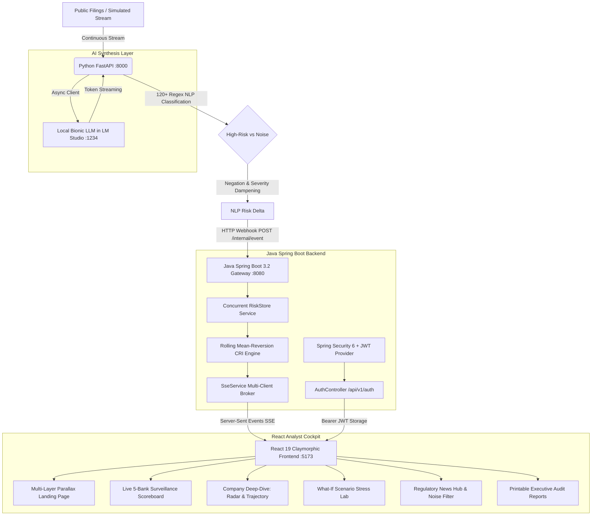

# 🛡️ RiskRadar AI — Automated Corporate Risk Radar
### Autonomous RegTech Surveillance & Rolling Corporate Risk Intelligence

> **DY Patil College Hackathon — Fintech / RegTech Track**  
> **Repository:** [https://github.com/pranav-6944/Riskradar-AI](https://github.com/pranav-6944/Riskradar-AI)  
> **Author & Lead Architect:** Pranav Lamkhade (B.Tech Computer Engineering & Data Science, MITAOE SPPU)

---

## 📌 Executive Summary & Problem Statement

Financial analysts spend **4 to 6 hours daily** manually reading hundreds of public regulatory complaints, CFPB enforcement actions, civil litigation filings, earnings call transcripts, and corporate news items to spot institutions heading into trouble. 

Most of this stream is unstructured and noisy (routine earnings, dividend declarations, charity galas), and the few items signaling serious operational or compliance threats are easy to miss. By the time a pattern is detected, regulatory fines and reputation damage have already escalated.

**RiskRadar AI** solves this with an end-to-end autonomous surveillance platform that:
1. **Continuously ingests** unstructured news, complaints, and regulatory filings for multiple institutions.
2. **Flags critical legal, compliance, and operational threats** while separating out general PR noise using 120+ regex patterns and negation dampening.
3. **Computes a rolling Corporate Risk Index (CRI)** using physical mean-reversion decay.
4. **Streams explainable on-premise Bionic LLM reasoning** via local LM Studio (`http://localhost:1234/v1`) with zero data leakage.

---

## 🏛️ Microservices Architecture



---

## 📊 Quantitative Physics: Rolling Corporate Risk Index (CRI)

Corporate risk behaves as an oscillating physical system rather than a static metric. In RiskRadar AI, the CRI is updated per incoming signal using an exponential mean-reverting differential formulation:

$$\text{CRI}(t) = \text{CRI}(t-1) \cdot (1 - \lambda) + B \cdot \lambda + \Delta \text{Risk}$$

- $\lambda = 0.05$: Velocity of mean-reversion (5% decay toward baseline per period).
- $B = 25.0$: Historical corporate risk baseline.
- $\Delta \text{Risk}$: Raw weighted NLP impact score multiplied by urgency multipliers ($1.4\times$ to $2.0\times$) or dampened by negation/noise factors ($0.15\times$ to $0.40\times$).

### The 5 Weighted Risk Vectors
| Vector | Weight | Key Regex Triggers |
|:---|:---:|:---|
| **Legal Exposure** | `10` | Lawsuit, class-action, indictment, securities fraud, DOJ, SEC subpoena, perjury |
| **Compliance Breach** | `8` | AML, KYC failure, FinCEN, CFPB complaint, OCC consent order, sanctions, GDPR |
| **Financial Distress** | `9` | Default, bankruptcy, credit downgrade, liquidity crisis, restatement, margin call |
| **Operational & Cyber**| `7` | System outage, ransomware, core banking disruption, CEO resign, union strike |
| **Reputational Damage**| `6` | Predatory lending, boycott, public outrage, whistleblower, ethics scandal |

---

## 🎨 Design Philosophy: Claymorphism & Parallax

The user interface is engineered according to modern tactile aesthetics:
- **Claymorphic 3D Cards:** Multi-layer outer drop shadows combined with inset highlights create inflated, tactile components.
- **Multi-Layer Parallax Scrolling:** Background atmospheric glow spheres, floating telemetry badges, and interactive radar dish previews move at differential velocities.
- **Real-Time Data Visualization:** Recharts polar radar plots, rolling sparklines, and area trajectory charts.
- **Responsive Layout:** Optimized for high-density analyst trading desks, tablets, and mobile devices.

---

## 🚀 Quick Start Guide

### Prerequisites
- **Java 17+ / 21**
- **Node.js 20+**
- **Python 3.10+**
- *(Optional)* **LM Studio** running locally at `http://localhost:1234/v1` with model `bionic`

---

### Step 1: Start the Java Spring Boot Gateway (:8080)
```powershell
cd api-service
.\mvnw.cmd spring-boot:run
```
> Gateway runs at **`http://localhost:8080`**.  
> Exposes JWT authentication, SSE broadcast at `/api/v1/stream`, and internal webhooks at `/internal/event`.

---

### Step 2: Start the Python FastAPI AI & NLP Service (:8000)
```powershell
cd ai-service
python -m pip install -r requirements.txt
uvicorn main:app --host 0.0.0.0 --port 8000 --reload
```
> NLP service runs at **`http://localhost:8000`**.  
> Interactive OpenAPI documentation available at **`http://localhost:8000/docs`**.

---

### Step 3: Start the React 19 Frontend (:5173)
```powershell
cd frontend
npm install
npm run dev
```
> Open your browser at **`http://localhost:5173`**.

---

## 🔑 Demo Judge Credentials

For hackathon evaluations, pre-seeded analyst accounts with single-click login are provided:

| Role | Email | Password |
|:---|:---|:---|
| **Lead Risk Analyst** | `analyst@riskradar.io` | `password123` |
| **Compliance Officer (Admin)** | `admin@riskradar.io` | `admin123` |

---

## 🧪 Key Pages & Features to Explore

1. **Parallax Landing Page (`/`)**: Multi-layer depth scroll, live mini-radar preview widget, and problem-vs-solution comparison.
2. **Surveillance Cockpit (`/dashboard`)**: Live SSE scoreboard tracking JPMorgan Chase, Goldman Sachs, Wells Fargo, Citigroup, and Bank of America with sparkline charts.
3. **Company Deep-Dive (`/company/GS`)**: Rolling historical CRI trajectory, 5-vector polar radar chart, and local Bionic LLM reasoning stream.
4. **Regulatory Stream & Noise Filter (`/news-hub`)**: Real-time event ticker with rapid injection buttons (`+ DOJ Threat`, `+ AML Sanctions`, `+ PR Noise`).
5. **What-If Scenario Stress Lab (`/simulator`)**: Interactive sandbox to test regulatory shocks and witness live cluster updates.
6. **Executive Audit Dossier (`/reports`)**: Formatted printable/exportable regulatory compliance report.

---

## 👨‍💻 Author & Acknowledgements

- **Developer:** Pranav Lamkhade
- **Degree:** B.Tech in Computer Engineering & Data Science
- **Institution:** MIT Academy of Engineering (MITAOE), affiliated with Savitribai Phule Pune University (SPPU)
- **Portfolio:** [https://pranav-6944.github.io/My_Portfolio/](https://pranav-6944.github.io/My_Portfolio/)
- **LinkedIn:** [https://www.linkedin.com/in/pranav-lamkhade-6b48bb372](https://www.linkedin.com/in/pranav-lamkhade-6b48bb372)
- **GitHub:** [https://github.com/pranav-6944](https://github.com/pranav-6944)

*Developed for DY Patil College Hackathon 2026.*
